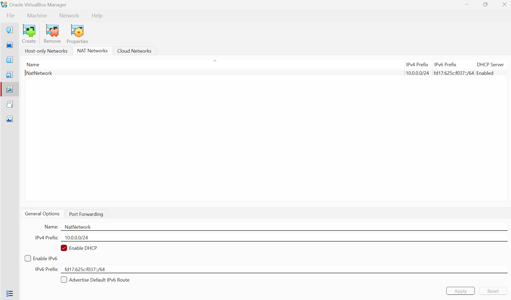
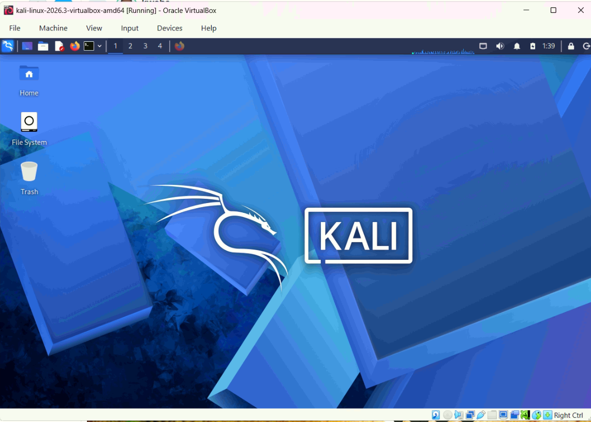
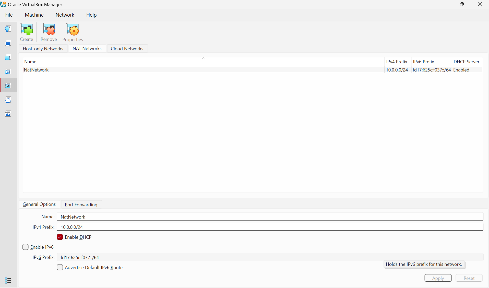
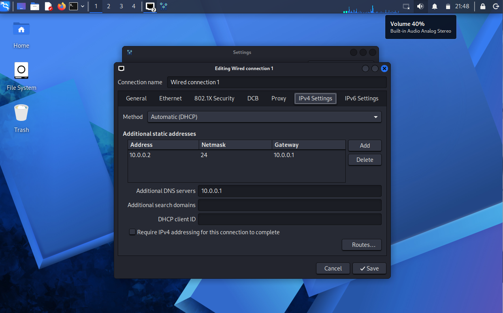
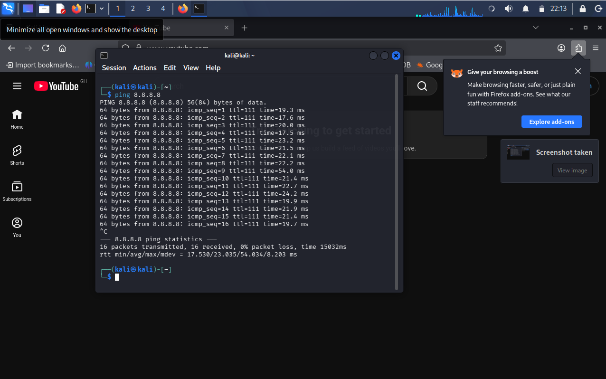
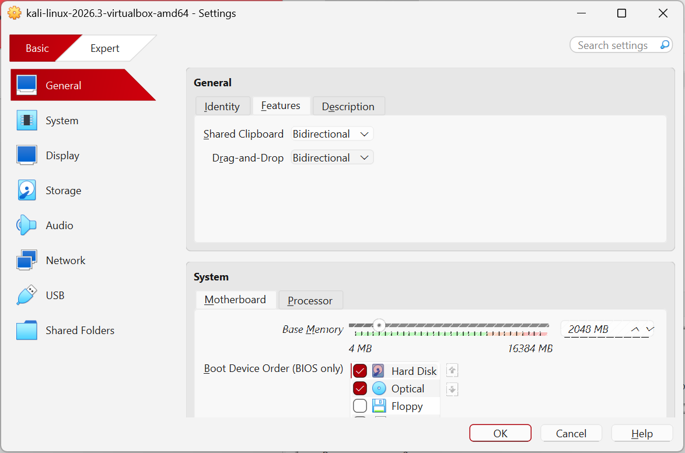
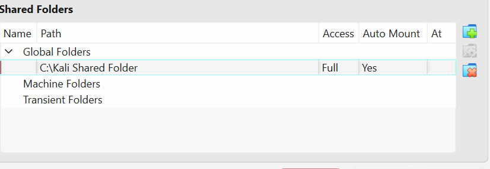

# 🔐 Cybersecurity Lab Setup with VirtualBox and Kali Linux

**Network Walks | Cybersecurity Lab Project**

A practical project documenting the setup of a virtual environment for cybersecurity learning, network testing, and authorised security experiments.

---

## 📌 1. Project Introduction

This project involves building a virtual cybersecurity lab using Oracle VirtualBox and Kali Linux. The goal is to prepare a Linux-based testing machine with a dedicated virtual network, internet connectivity, and host-to-guest integration features.

Virtualisation allows the lab to run independently of the host operating system while making it easier to manage the testing environment.

The lab uses a NAT Network with the `10.0.0.0/24` subnet. Kali Linux is intended to use the static IP address `10.0.0.2/24`.

This environment provides a foundation for future cybersecurity exercises in an authorised and controlled setting.

## 🎯 2. Project Goals

The main goals of this project are to:

- Set up Oracle VirtualBox as the virtualisation platform.
- Install or import Kali Linux as the testing machine.
- Configure a NAT Network using the `10.0.0.0/24` subnet.
- Assign Kali Linux the required IP address, `10.0.0.2/24`.
- Establish and verify internet connectivity.
- Enable shared clipboard and drag-and-drop functionality.
- Configure a shared folder linked to the host's `/downloads` directory.
- Capture screenshots documenting the configuration and verification process.

## 🏗️ 3. Lab Architecture

The laboratory consists of a host computer running VirtualBox and a Kali Linux virtual machine connected to a dedicated NAT Network.

```text
┌─────────────────────────────────────┐
│           Host Computer             │
│                                     │
│  Host Operating System              │
│  Shared Folder: /downloads          │
│                                     │
│           Oracle VirtualBox          │
│                  │                  │
│        ┌─────────▼─────────┐        │
│        │    NAT Network    │        │
│        │  10.0.0.0/24      │        │
│        └─────────┬─────────┘        │
│                  │                  │
│        ┌─────────▼─────────┐        │
│        │    Kali Linux     │        │
│        │  10.0.0.2/24      │        │
│        │  Testing Machine  │        │
│        └───────────────────┘        │
└─────────────────────────────────────┘
                  │
                  ▼
            Internet Access
```

*Figure 1: Conceptual architecture of the virtual cybersecurity lab.*

The NAT Network provides a way for connected virtual machines to communicate with one another while accessing external networks through network address translation. Additional lab machines can be introduced later, provided they are configured to use the same virtual network.

## ⚙️ 4. Lab Specifications

| Component | Required configuration |
|---|---|
| Virtualisation software | Oracle VirtualBox |
| Guest operating system | Kali Linux |
| Network mode | NAT Network |
| Network subnet | `10.0.0.0/24` |
| Kali IPv4 address | `10.0.0.2/24` |
| Subnet mask | `255.255.255.0` |
| Internet connectivity | Required |
| Shared clipboard | Enabled |
| Drag and drop | Enabled |
| Host shared directory | `/downloads` |

*Note: The host operating system, RAM allocation, CPU model, VirtualBox version, gateway, and DNS server should be documented using the actual values from your environment.*

## 🪜 5. Lab Setup and Configuration

### Step 1 — Prepare VirtualBox

Oracle VirtualBox was used as the base platform for creating and managing the virtual machine.  

The installation and initial setup provided the environment needed to run Kali Linux on the host computer.

**Screenshot 1: VirtualBox interface**



### Step 2 — Set Up Kali Linux

Kali Linux was selected as the guest operating system because it provides tools commonly used for security assessment, network analysis, and penetration-testing education.

The virtual machine was prepared using the appropriate Kali Linux installation or prebuilt virtual-machine image.

**Screenshot 2: Kali Linux virtual machine in VirtualBox**



### Step 3 — Create the Virtual Network

A dedicated NAT Network was configured in VirtualBox using the required subnet:

`10.0.0.0/24`

The Kali Linux network adapter was connected to this network.

Using a dedicated NAT Network allows the lab to be expanded with additional virtual machines in future exercises.

**Screenshot 3: NAT Network configuration**



### Step 4 — Configure Kali Linux Networking

Kali Linux was required to use the IPv4 address `10.0.0.2` with a `/24` prefix.

The interface configuration and routing table can be inspected with:

The IP configuration, default gateway, and DNS settings should be checked to ensure they are consistent with the VirtualBox NAT Network configuration.

**Screenshot 4: Kali Linux IP configuration**



### Step 5 — Test Internet Connectivity

Network connectivity should be verified from inside Kali Linux rather than assumed from the VirtualBox settings alone.

Test connectivity to a public IP address:

```bash
ping  8.8.8.8
```

Test DNS resolution:

```bash
getent hosts google.com
```

Successful results help confirm external IP connectivity and domain-name resolution.

**Screenshot 5: Connectivity verification**



### Step 6 — Enable Clipboard and Drag-and-Drop

The virtual machine's General or Advanced settings were used to configure the following integration features:

- **Shared Clipboard:** Bidirectional
- **Drag and Drop:** Bidirectional

These features allow supported text and file transfers between the host and guest systems. VirtualBox Guest Additions may be required for the features to work correctly.

**Screenshot 6: Integration settings**



### Step 7 — Configure the Shared Folder

The host's `/downloads` directory was specified as the shared folder for the Kali Linux virtual machine.

The shared-folder configuration should be checked for the correct host path, folder name, and access settings. If the guest cannot access the directory, check Guest Additions and the relevant permissions.

**Screenshot 7: Shared folder configuration**



### Step 8 — Perform Final Checks

The completed environment should be checked against the original task requirements.

The final checks should confirm:

- Kali Linux starts successfully.
- The IP address matches `10.0.0.2/24`.
- Internet connectivity and DNS resolution work.
- Clipboard and drag-and-drop are enabled and functional.
- The shared folder is configured and accessible.


## 🔎 6. Verification Summary

| Test | Verification method | Expected outcome |
|---|---|---|
| IP address | `ip addr show` | `10.0.0.2/24` on the correct interface |
| Network route | `ip route` | Appropriate default route is present |
| External connectivity | `ping -c 4 8.8.8.8` | Replies, where ICMP is permitted |
| DNS resolution | `getent hosts google.com` | A valid address is returned |
| Clipboard | Copy and paste a test string | Transfer works in both directions |
| Drag and drop | Transfer a test file | Transfer works in both directions |
| Shared folder | Open the configured guest mount | Host files are accessible as intended |

**Important:** These are the verification procedures and expected outcomes, not claims that the tests have already passed. Record the actual results after performing them.

## 🧠 7. Technical Observations and Learning Outcomes

This project provides practical experience with several important infrastructure concepts.

**Virtualisation:** VirtualBox makes it possible to run a separate operating system without installing it directly on the host computer.

**Virtual networking:** A NAT Network provides connectivity for multiple virtual machines on the same virtual network, along with outbound connectivity through NAT.

**IPv4 addressing:** Configuring the required IP address and subnet mask helps establish predictable network addressing within the lab.

**Connectivity troubleshooting:** Checking the IP address, routing table, external connectivity, and DNS resolution helps separate different types of network problems.

**Host–guest integration:** Clipboard sharing, drag-and-drop, and shared folders provide ways to exchange information between the host and virtual machine.

**Technical documentation:** Screenshots and verification results make the configuration easier to review, reproduce, and troubleshoot.

## 🛡️ 8. Security and Responsible Use

This environment is intended for cybersecurity education and authorised testing.

- Test only systems you own or have explicit permission to assess.
- Keep the virtualisation platform and guest operating system updated.
- Verify which network interfaces and adapters are connected before performing security tests.
- Use VM snapshots where appropriate to preserve a clean recovery point.
- Avoid placing sensitive information in shared folders.

## 📂 9. Repository Structure

The repository is organised to keep the report and supporting evidence together.

```text
virtual-cybersecurity-lab/
├── README.md
└── screenshots/
    ├── 01-virtualbox.png
    ├── 02-kali-vm.png
    ├── 03-nat-network.png
    ├── 04-kali-ip-address.png
    ├── 05-internet-connectivity.png
    ├── 06-clipboard-drag-drop.png
    ├── 07-shared-folder.png
    └── 08-final-verification.png
```

The screenshot filenames in the report must match the actual filenames committed to GitHub. Replace any placeholder images with genuine screenshots from your lab.

## 🔗 10. Official Resources

- [Oracle VirtualBox Downloads](https://www.virtualbox.org/wiki/Downloads)
- [Oracle VirtualBox User Manual](https://www.virtualbox.org/manual/)
- [Download Kali Linux](https://www.kali.org/get-kali/)
- [Kali Linux Documentation](https://www.kali.org/docs/)

## 👤 11. Project Information

- **Programme:** Network Walks Cybersecurity Training
- **Project:** Virtual Cybersecurity Lab Setup
- **Platform:** Oracle VirtualBox
- **Guest OS:** Kali Linux
- **Submission:** GitHub repository

---

